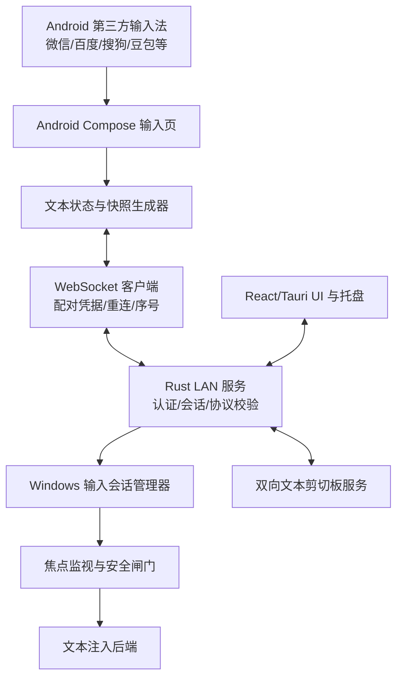

# 技术架构

## 1. 总体架构



## 2. 技术栈

### Android
- Kotlin
- Jetpack Compose
- Coroutines + Flow
- OkHttp WebSocket 或 Ktor Client（二选一，MVP 统一使用一个）
- Android Keystore 保存设备凭据
- DataStore 保存设置
- mDNS/NsdManager 可后置；MVP 支持扫码/输入 IP

### Windows
- Tauri 2
- React + TypeScript
- Rust
- Tokio 异步运行时（如与所选 Tauri 运行时冲突，按项目模板约束处理）
- WebSocket 服务端（如 tokio-tungstenite）
- Windows API 封装在 `windows-input` 模块
- 系统托盘由 Tauri 插件/能力实现；不得将系统权限逻辑放入 React。

## 3. 建议仓库结构

```text
lan-voice-bridge/
├─ README.md                 # 项目入口、构建与 CI 使用说明
├─ .github/workflows/build.yml
├─ Docs/                     # 产品与开发文档
│  ├─ README.md
│  ├─ PRD.md
│  ├─ ARCHITECTURE.md
│  ├─ PROTOCOL.md
│  ├─ SECURITY.md
│  ├─ TASKS.md
│  ├─ ACCEPTANCE_TESTS.md
│  └─ CLAUDE.md
├─ android/
│  └─ app/src/main/java/.../
│     ├─ ui/
│     ├─ input/
│     ├─ network/
│     ├─ pairing/
│     ├─ clipboard/
│     ├─ service/
│     └─ data/
└─ windows/
   ├─ src/
   │  ├─ components/
   │  ├─ pages/
   │  └─ state/
   └─ src-tauri/src/
      ├─ server/
      ├─ protocol/
      ├─ pairing/
      ├─ input_session/
      ├─ focus/
      ├─ input_backend/
      ├─ clipboard/
      ├─ tray/
      └─ logging/
```

## 4. Android 文本输入设计

### 4.1 输入框

使用 Compose `BasicTextField` 或 `TextField`。如需读取输入法组合区状态，优先采用可暴露 `TextFieldValue`/文本编辑状态的实现，并记录 selection 与 composition（如果 API 可用）。

数据层至少保存：
- `text`: 当前可见文本。
- `selectionStart` / `selectionEnd`：光标/选区。
- `compositionStart` / `compositionEnd`：输入法组合区，可能为空。
- `revision`: 本地递增版本。
- `sessionId`: 当前输入会话。

### 4.2 文本发送策略

- 监听实际文本状态变化，不监听麦克风或识别引擎。
- 对高频变化做短窗口合并（初始 50 ms，可配置）。
- 发送完整文本快照，不只发送追加字符。
- 如果 IME 提交整句或回改旧文本，快照仍能表示最终状态。
- 默认发送 `text` 与 selection；composition 作为可选诊断字段，不依赖所有 IME 都提供。
- 语音识别临时结果是否出现在 App 文本框由输入法决定；App 不保证获得输入法内部尚未提交的私有候选内容。

### 4.3 自动弹出键盘

- Activity 在前台且用户主动打开时，聚焦输入框。
- 在窗口获得焦点后调用 `SoftwareKeyboardController.show()` 或等效机制。
- 通知操作必须由用户点击，并通过 PendingIntent 打开 Activity。
- Android 系统可能延迟或拒绝后台键盘弹出；不得使用后台启动 Activity 绕过系统限制。
- 不自动点击 IME 麦克风；用户自行操作输入法。

### 4.4 Android 剪切板限制

- Android 对后台剪切板读取有限制；Android 10+ 对后台读取限制尤其重要，更新版本还可能显示剪切板隐私提示。
- MVP 不依赖后台持续读取剪切板。
- Android → Windows：用户前台点击“发送剪切板”，或在 App 前台通过明确操作读取。
- Windows → Android：收到远端文本后，仅在前台/用户明确允许时更新 Android 系统剪切板；否则显示“点按复制”按钮。
- 通知快捷入口负责打开输入页，不保证在后台直接弹出键盘。

## 5. Windows 实时文本注入

### 5.1 核心风险

Windows 没有一个适用于所有应用的通用 API，可以可靠地把远程文本插入任何控件并精确替换先前内容。浏览器、Win32 控件、终端、自绘控件、远程桌面、游戏及提升权限应用的行为可能不同。

### 5.2 MVP 输入会话

1. 用户在 Windows 明确点击“开始输入”或触发快捷键。
2. Rust 记录当前前台窗口句柄、进程 ID、可获取的焦点信息、会话 ID。
3. 目标窗口若不符合策略或权限级别不匹配，则拒绝启动并提示。
4. Android 首次快照作为当前会话的文本状态。
5. 每次快照与上次已应用文本做差异比较。
6. 仅当焦点仍属于已确认目标时执行输入。
7. 焦点变化、窗口最小化/关闭、会话超时、设备断开或用户停止时，停止注入。
8. 不自动切换窗口，不自动重新聚焦原窗口，不将内容粘贴到新焦点。

### 5.3 差异更新算法

MVP 先限制目标场景为“会话开始时光标位于输入末尾，用户在会话期间不移动光标、不切换目标控件”。

- 维护 `lastAppliedText` 与 `newText`。
- 计算两者最长公共前缀（按 Unicode 字符边界/文本元素安全处理，不能把 UTF-16 代理对拆开）。
- 回退旧文本在公共前缀之后的尾部，再输入新尾部。
- 如果目标应用无法可靠支持回退/输入，暂停并提示使用“整段发送/粘贴”模式。
- 文本注入必须处理换行、制表符、emoji、组合字符、Unicode 字符。
- 对大文本可以使用剪切板 + 粘贴，但必须只在用户明确授权的输入会话中使用，并且不能把完整快照反复粘贴到当前文档造成重复。

**禁止实现**：每次文本变化都直接 `Ctrl+A` 后粘贴完整文本。这会选中目标文档的全部内容，属于高风险实现。

### 5.4 焦点安全

- 输入会话启动时捕获目标窗口。
- 每次应用文本前重新验证前台窗口/目标焦点。
- 焦点变化时立即暂停，显示状态，不尝试追随新焦点。
- Windows 权限完整性级别不匹配时（例如普通权限应用向管理员窗口输入），拒绝或提示以一致权限运行；不得尝试绕过 UAC。
- 用户停止会话后，任何延迟消息都必须因 sessionId 不匹配而丢弃。

### 5.5 注入后端抽象

定义 `TextInjectionBackend`，至少预留：
- `UnicodeSendInputBackend`：适用于常见普通文本控件；处理 UTF-16、按键与错误。
- `ClipboardPasteBackend`：用于大段文本或 UnicodeSendInput 不兼容场景；必须保护原剪切板并在失败时恢复（尽力而为，不能承诺对所有剪切板管理器无副作用）。
- 后续可加入应用专用适配器。

## 6. 网络服务

- Windows Rust 端提供 WebSocket 服务。
- 只绑定用户明确选择的私有 LAN 接口/地址；默认拒绝公网接口和不必要的 IPv6 公网监听。
- 初版可由用户扫码确认 Windows IP/端口；mDNS 自动发现后置。
- 配对完成后要求认证；未知设备握手失败。
- 每条消息校验协议版本、长度上限、sessionId、seq 与消息类型。
- 断线采用指数退避重连，随机抖动并设置最大等待。
- 连接恢复后不自动恢复旧输入会话；需要新会话，防止旧文本写入新焦点。

## 7. 延迟与流量

- 文本变化合并窗口默认 50 ms。
- 只在文本状态变化时发送，不定时发送全量快照。
- 快照默认最大 256 KiB；超限显示错误，不截断静默发送。
- P95 目标 ≤ 150 ms（从 App 状态变化到 Windows 开始注入，不含语音识别延迟）。
- 记录延迟指标但不记录文本内容。

## 8. 可观测性与错误处理

- 使用结构化日志：时间、模块、事件类型、sessionId 的短哈希、seq、耗时、错误码。
- 禁止日志写入文本正文、剪切板正文、pairing secret、访问令牌。
- UI 状态：未配对、等待连接、已连接、输入会话中、焦点暂停、认证失败、注入失败。
- 关键错误可复制诊断信息，自动脱敏。

## 9. 测试策略

- Android 单元测试：文本快照、去抖、序号、断线、剪切板回环。
- Rust 单元测试：协议验证、会话状态机、快照差异算法、权限策略。
- Windows 手工集成测试：记事本、浏览器文本框、VS Code 普通编辑区、微信/常用 IME（Windows 端）。
- Android 手工测试：微信输入法、百度输入法、搜狗输入法、豆包输入法；每个输入法测试实时中间结果、最终提交、整句回改与长停顿。
